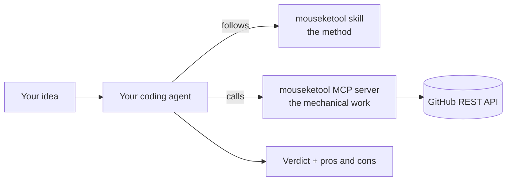

# mouseketool

[](https://github.com/iDiagoValeta/mouseketool/actions/workflows/ci.yml)
[](LICENSE)


**Before you build something new, find out whether it already exists.**

mouseketool gives your coding agent a disciplined way to answer one question at the moment you decide to build: *is there already a public project that does this, or that I can start from?* It searches GitHub, checks the candidates for real (health, license, and the code behind each README's claims) and answers with a verdict weighed against your own requirements: **reuse**, **adapt**, **use as a base**, or **build from scratch**.

## Contents

- [Why](#why)
- [How it works](#how-it-works)
- [Example](#example)
- [Quick start](#quick-start)
- [Configuration](#configuration)
- [MCP tools](#mcp-tools)
- [The method](#the-method)
- [Health signals](#health-signals)
- [Architecture](#architecture)
- [Development](#development)
- [Evaluation](#evaluation)
- [Limitations](#limitations)
- [Contributing](#contributing)
- [License](#license)

## Why

With a coding agent, writing a tool is often cheaper than finding out that someone already wrote it. So developers rebuild, from scratch, things a mature project already covers or could serve as a base for. The cost shows up later: maintenance nobody planned, edge cases the existing project solved years ago, and time spent on work that adds nothing new.

mouseketool steps in at the "moment zero" of an idea, when it exists but no code does, and turns "I want to build X" into a short, evidence-backed decision.

## How it works

It has two parts and **no LLM of its own**: your agent's model does all the judging.



- **The MCP server** (`dist/server.mjs`) does the mechanical work: many GitHub searches in one call, repository inspection (README, file tree, activity, releases, issues, contributors, license) and file reads. It computes plain health signals and makes no judgment.
- **The Agent Skill** (`skills/mouseketool/SKILL.md`) teaches the agent the method: read the idea, expand it into queries, search, inspect a handful of candidates, confirm the key capabilities in the code, and answer verdict first.

The skill triggers by itself when you want a new reusable tool, app, service or library to exist, whether you describe it in one vague sentence or in a full requirements list. It stays silent on small tasks: a one-off script, a fix, a new flag.

## Example

Asked for a command line tool that makes a video of a GPS track drawn on a map, from GPX files, the agent answered (shortened):

```
Verdict: reuse time4tea/gopro-dashboard-overlay

It already makes an MP4 from GPX alone via `--use-gpx-only`, is CLI-first, and supports ~30 map styles.
Main gaps: one GPX per run, and no built-in speed/duration multiplier.

time4tea/gopro-dashboard-overlay: 589 stars, 22 contributors, Python, GPL-3.0, actively released on PyPI
- Pros: `gopro-dashboard.py --use-gpx-only --gpx ride.gpx --overlay-size 1920x1080 out.mp4` works without
  any source video; map route widget; 30 map styles; fully scriptable.
- Cons: one `--gpx` per invocation; no speed multiplier; GPL-3.0 matters if you ship closed-source.

progweb/gpx2video: 314 stars, active, C++, GPL-3.0
- Cons: requires an input video; it overlays onto footage rather than creating a video from the track
  alone, so it misses a must-have.
```

The first line is always one of four verdicts:

| Verdict | Meaning |
|---|---|
| `Verdict: reuse owner/name` | Use it as is. |
| `Verdict: adapt owner/name` | Fork or modify it to fit. |
| `Verdict: base owner/name` | Build on top of it as a foundation. |
| `Verdict: build` | Nothing fits: build from scratch, optionally borrowing a piece from a named project. |

A candidate that misses a must-have is never recommended for reuse or adaptation. When nothing fits, the answer says so.

## Quick start

### Requirements

- Node.js 24 or later and [pnpm](https://pnpm.io/).
- A GitHub token: `GITHUB_TOKEN`, or a login with the [GitHub CLI](https://cli.github.com/) (`gh auth login`). No scope is needed beyond reading public repositories.
- A host agent: [Claude Code](https://docs.claude.com/en/docs/claude-code) or [opencode](https://opencode.ai/).

### Install

```bash
git clone https://github.com/iDiagoValeta/mouseketool.git
cd mouseketool
pnpm install --frozen-lockfile
pnpm build
```

`dist/` is not committed, so `pnpm build` is required before either host can start the server.

### Claude Code

The repository is a Claude Code plugin: `.claude-plugin/plugin.json` declares the server, and the skill is in `skills/`.

```bash
claude --plugin-dir /path/to/mouseketool
```

Then describe what you want to build. The skill appears as `mouseketool:mouseketool`, and the tools as `mcp__plugin_mouseketool_mouseketool__*`.

### opencode

1. Copy `skills/mouseketool/` into a skills directory opencode reads: `.opencode/skills/`, `.claude/skills/` or `.agents/skills/` in a project, or `~/.config/opencode/skills/`, `~/.claude/skills/` or `~/.agents/skills/` globally.
2. Add the server to your `opencode.json`, as in [`opencode.example.json`](opencode.example.json), with the absolute path to `dist/server.mjs`.

For headless `opencode run`, pass `--standalone`; otherwise it talks to the background service, which has the global config loaded.

## Configuration

The server is configured through environment variables only.

| Variable | Required | Purpose |
|---|---|---|
| `GITHUB_TOKEN` | No, if `gh` is logged in | GitHub token. When unset, the server runs `gh auth token`. Without either it refuses to start: unauthenticated search limits are too low to be useful. |
| `MOUSEKETOOL_RUN_LOG` | No | Path of a JSONL file that records, per tool call, the tool name and the repositories it returned. Used by the eval to tell searched repositories from remembered ones. Never contains the token. |

The token is validated on startup, sent only to `api.github.com`, and never logged, returned in a tool result or written to the run log. Error messages from GitHub are sanitised before they reach the agent.

## MCP tools

| Tool | Input | Returns |
|---|---|---|
| `search_repositories` | `queries`: 1 to 15 GitHub search queries | Up to 40 merged candidates (name, url, description cut at 350 characters, stars, last push, SPDX license, topics, archived, language, how many queries matched), ranked by queries matched and then stars, plus per-query errors. |
| `inspect_repository` | `repo`: `owner/name` or a GitHub URL | Candidate metadata, health signals, activity of the last 90 days (commits, closed and open issues, contributors, latest release), the README truncated to 12,000 characters, and the top-level file list. |
| `read_repository_file` | `repo`, `path` relative to the root | The file text, truncated to 20,000 characters, or `null` with a reason when the file is binary or missing. |

Searches are queued to at most 30 per minute and sent one at a time. The server reads GitHub's quota headers and waits for the reset when the quota runs out, so several agents sharing one token do not fail on each other; a wait longer than 60 seconds is reported as an error instead of blocking the agent.

## The method

The skill walks the agent through seven steps:

1. **Gate.** Run only when the user wants a new reusable tool, app or service to exist. Otherwise stop silently.
2. **Read the input.** Split must-haves from nice-to-haves, note the intended use and stack constraints, and ask at most two questions, only if the answer would change the verdict. A vague idea gets a wide map of the space; a requirements document gets a requirement-by-requirement analysis.
3. **Expand.** Write 8 to 15 short, varied queries: synonyms, community names, `topic:` qualifiers, and `stars:>50` on at least half, so mature projects are not buried.
4. **Search and shortlist.** One call with all queries; drop archived, stale and off-target candidates.
5. **Inspect.** At most six candidates. Drop those whose license blocks the stated use, and confirm every capability the verdict depends on in the code, not just in the README.
6. **Judge.** Coverage per must-have, health, adoption, license fit and the effort of adapting versus building. Between candidates that cover the must-haves, prefer the one people actually use.
7. **Answer.** Verdict first, a three-line summary, then pros and cons per candidate against the user's goal.

## Health signals

Computed by the server, without judgment, and returned as plain fields:

| Field | Values | Rule |
|---|---|---|
| `archived` | `true` / `false` | As reported by GitHub. |
| `stale` | `true` / `false` | Last push more than 18 months ago. |
| `maintenance` | `active` / `slow` / `inactive` | 5 or more commits in the last 90 days / 1 to 4 / none. |
| `licenseKind` | `permissive` / `copyleft` / `none` / `other` | From the SPDX id: MIT, Apache-2.0, BSD, ISC, 0BSD, Unlicense and Zlib are permissive; GPL, AGPL, LGPL, MPL and EPL are copyleft; no license blocks all use; anything else must be read. |

## Architecture

Hexagonal (ports and adapters). Dependencies point inward, and ESLint enforces it in `pnpm lint`.

```
src/
├── domain/              pure model: repository names, candidates, health signals
├── application/         use cases: search, inspect, read file
│   └── ports/           RepositorySource and RunLog, with their technology-neutral errors
├── infrastructure/
│   ├── github/          RepositorySource over the GitHub REST API, rate limiter, token
│   ├── run-log/         JSONL and no-op RunLog
│   └── mcp/             the MCP stdio server (driving adapter)
├── composition-root.ts  the only place that wires adapters to ports
└── main.ts              entry point
```

- `domain` and `application` import no adapter, MCP SDK, `node:fs` or `node:child_process`.
- The MCP adapter cannot import the GitHub or run-log adapters; it sees only the ports.
- `test/architecture/contract.test.ts` proves both rules still fire on a known violation, and `.hexagonal.json` declares the layers for architecture audits.
- Use cases are tested against in-memory doubles in `test/doubles/`.

## Development

| Command | What it does |
|---|---|
| `pnpm check` | Typecheck, lint (including the layer rules) and tests. Run it before pushing. |
| `pnpm test` | Vitest only. |
| `pnpm build` | Bundles `src/main.ts` into `dist/server.mjs`. |
| `pnpm eval` | Runs the evaluation harness (see below). |

The GitHub adapter has a live test against `api.github.com`, which runs only with `MOUSEKETOOL_LIVE=1`; the rest of the suite needs no network. CI runs `pnpm check` on every pull request.

## Evaluation

The eval in `evals/` runs the whole method headless, one case after another, against real models and the real GitHub API. It is not part of CI, because it needs a model and costs tokens.

### Cases

- **20 positive cases** built on real, not famous, projects, so a model cannot answer from memory. Each has two versions: a vague one-sentence intent to build, and a defined list of must-haves and nice-to-haves. Each version carries its own concrete must-haves.
- **6 negative cases**: invented ideas no real project covers. The right answer is to build.
- **6 trigger cases**: small tasks where the skill must stay silent.
- **6 partial cases**: ideas a mature project covers only in part, such as an animated ASCII illustration tool on top of an ASCII animation library. The right answer is `base` with that project. Each has the whole idea's must-haves and the narrower must-haves a project needs to be the right base.

### Scoring

A positive run is a **hit** when all three hold:

1. the host triggered and recommended a project (`reuse`, `adapt` or `base`);
2. that project appeared in the server's search results during the run, which rules out an answer from memory;
3. a judge confirms the project meets every must-have of the version the host was given.

Any project that meets the must-haves counts, not only the one the case was built on. The judge is a separate Claude Code run on Sonnet 5.5 with only the mouseketool tools. A judgment counts only if the judge really inspected the repository. Judgments are cached in `.dev/eval-reports/judgments.json`; delete it after changing the judge.

A **negative** run passes with `build` or `base`. It fails with no verdict line, or with `reuse` or `adapt` of a project the judge rejects or the search never returned. If the judge accepts the recommended project, a real project covers the case, and the pass is reported as a FAIL until the case is replaced.

A **partial** run is a hit when the host answers `base` with a project from the search results that the judge confirms meets the base's must-haves (up to 3 recommended projects are judged). `build` misses, because a mature base exists. `reuse` or `adapt` misses, unless the judge finds that a recommended project meets the whole idea: then the case is wrong and is reported as a FAIL until it is replaced.

Every positive hit, partial hit and negative pass also needs the host to have read code with `read_repository_file`, as the skill requires. A run that would pass without it scores as a miss and is flagged `noCodeRead`.

A **trigger** run passes when the server was never called.

### Hosts and isolation

Runs are split between Claude Code with Sonnet 5.5 and opencode with `deepseek/deepseek-flash`, about 36 and 22 per pass, rotating between passes. Both hosts must be installed and logged in.

Hosts read untrusted READMEs and code, and the server they start needs the GitHub token. So each run gets a fresh `0700` directory, an allowlisted environment, and no shell or web tools:

- **Claude Code** runs in `work/` with the skill and read-only file tools (Read, Glob, Grep) pre-approved only inside it, in `dontAsk` mode, which denies everything else. The server config with the token sits one level up, out of reach; a live check confirmed that reading it, or the `gh` login in `HOME`, is denied. No write tool is given, so the host cannot plant a skill or a hook in its own workspace.
- **opencode** has every built-in tool denied except loading the skill and `execute`, the sandbox its MCP tools run in, which has no file, process or shell access.

Interrupting the eval removes the live workspaces.

### Running it

```bash
pnpm eval --calibrate      # judge each case's known projects (and each partial case's known bases) first: checks the judge and the requirements
pnpm eval --pass 0         # a full pass; --only <caseId> and --host <host> run a subset
```

Reports are written to `.dev/eval-reports/`. A pass succeeds when every host, on its own share, reaches hits on at least 80% of defined inputs and 60% of vague ones, gets at least 5 of 6 negatives right, reaches at least half of its partial cases, and never triggers on a small task.

### Results

Pass 0 on 2026-11-04 with the final code, 52 runs, both hosts within every threshold. The Sonnet share was rerun after its file tools were made read-only, and the opencode share is unchanged since:

| Host | Runs | Defined | Vague | Negatives | Small tasks |
|---|---|---|---|---|---|
| Claude Code, Sonnet 5.5 | 32 | 92% | 75% | 100% | 100% |
| opencode, deepseek-flash | 20 | 100% | 100% | 100% | 100% |

In three cases the host recommended a mature project other than the one the case was built on, and the judge confirmed it meets the must-haves: `time4tea/gopro-dashboard-overlay` for GPS track videos, `abhixdd/uptimekit-cli` for terminal site monitoring and `exiftool/exiftool` for stripping image metadata. Sonnet's vague misses recommended the right project but had not found it through the search, so the eval counts them as answers from memory. Its defined miss recommended a domain checker that cannot print only the available names, a must-have of that case.

Every run, with the host's full answer and the judge's verdicts, is in [`evals/results/2026-11-04/`](evals/results/2026-11-04/README.md).

## Limitations

- GitHub is the only source. Package registries such as npm or PyPI are not searched yet.
- It recommends; it does not fork, clone or adapt anything for you.
- The quality of the verdict depends on the host model. Small models were tried and dropped: they often fail to recognise a vague idea as something to research.
- Activity counts are approximate: GitHub's open-issue count includes pull requests, and contributors are counted up to 100.

## Contributing

Trunk-based: short-lived branches from `main`, one change per pull request, squash-merged. Every pull request links an issue, and commits follow [Conventional Commits](https://www.conventionalcommits.org/) with a body that explains why. Run `pnpm check` before pushing. See [`AGENTS.md`](AGENTS.md) for the full conventions.

## License

[MIT](LICENSE)
